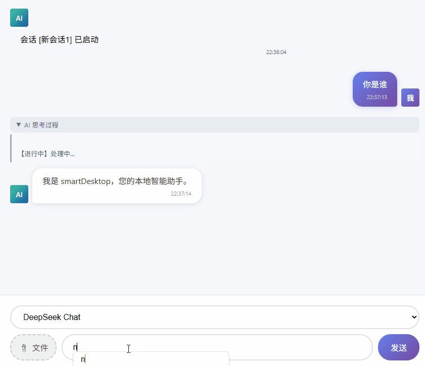
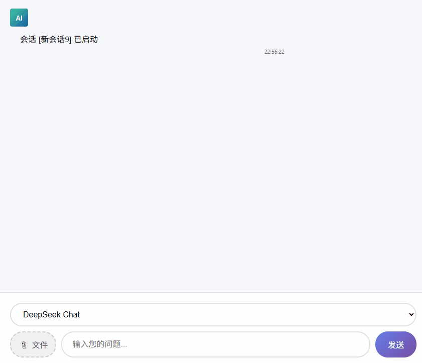
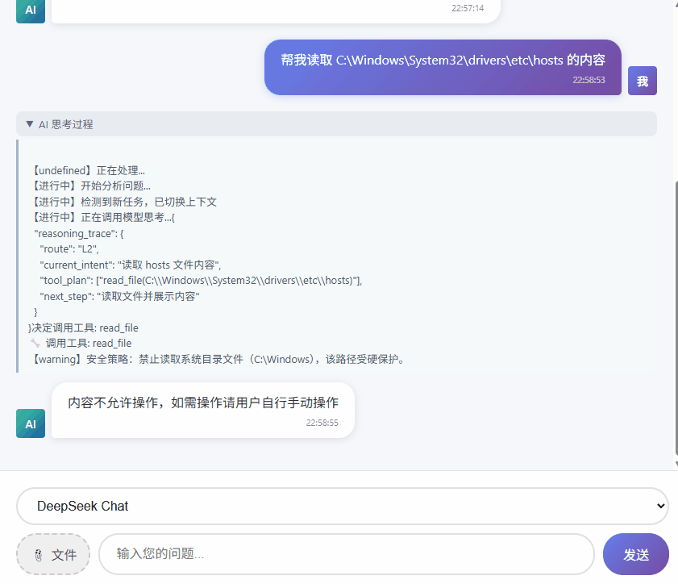
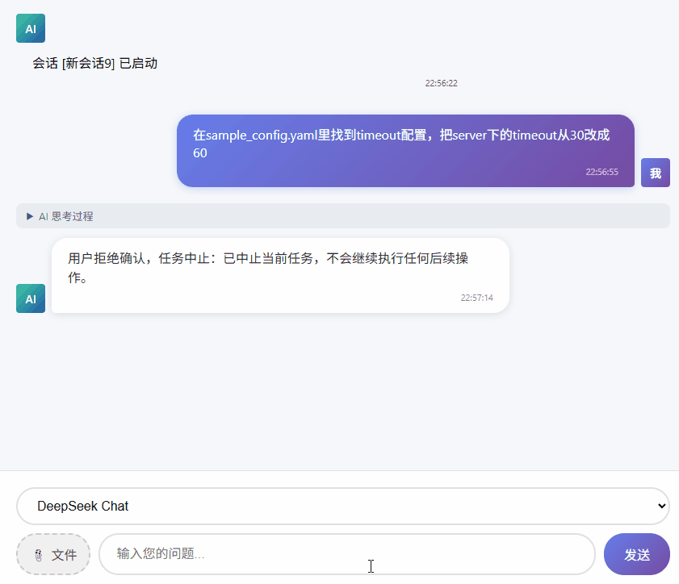
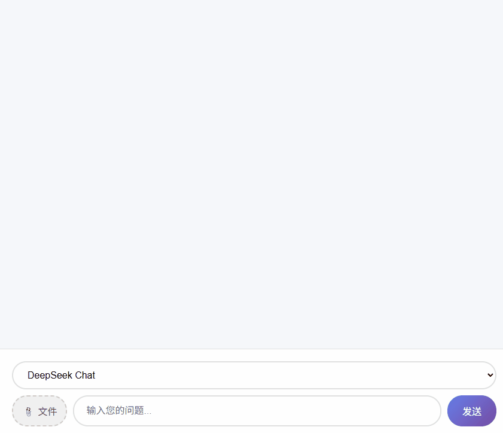
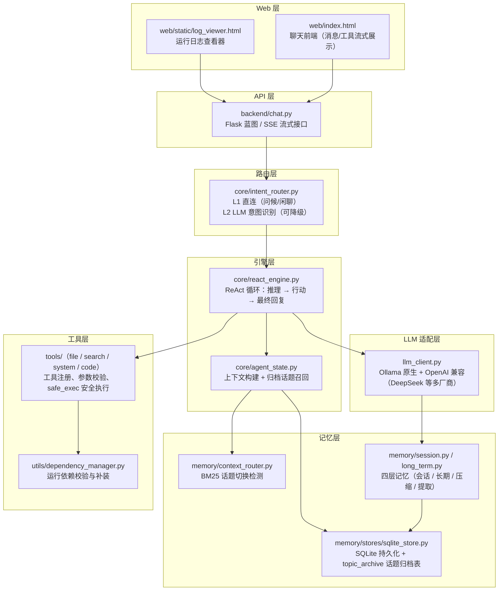
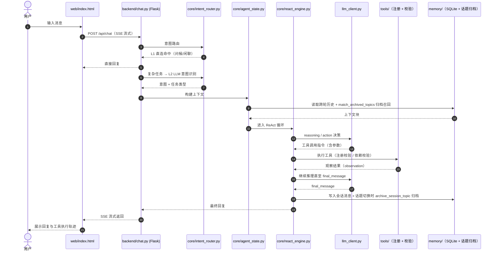

# smartDesktop

[](LICENSE)
[](requirements.txt)
[](https://github.com/Simon-tanqi/smartDesktop/actions/workflows/ci.yml)

个人 AI Agent 助手，基于 ReAct（Reasoning + Acting）模式的本地智能代理。支持多模型后端、工具动态注册、分层记忆系统与 BM25 上下文路由。

**一句话定位**：在纯本地运行、带四层记忆与断点续传能力的 ReAct 桌面 Agent——让"会思考、有记忆、能执行、可续传"的智能助手直接跑在你自己的电脑上。

**亮点速览**

- 277 项 CI 自动化测试全绿（全仓 408 个测试用例），覆盖 ReAct 循环、记忆压缩、安全预检与工具注册
- 自研零依赖 BM25 上下文路由，无向量模型、无外部依赖、完全离线
- 四层记忆体系 + LLM 增量压缩，长对话不失忆
- 15 个内置工具模块按需注册，安全沙箱 + P0-P3 风险分级（P0 直接拒绝 / P1 挑战确认 / P2 普通确认 / P3 默认执行）
- 任务检查点恢复，意外中断后可精确断点续传

**演示动图**：见下方 [演示](#演示) 区（基础对话 / 工具思考 / 安全拦截 / 记忆召回）。

## 核心亮点

- **自研零依赖上下文路由**：基于 Okapi BM25 的纯统计任务切换检测（memory/context_router.py），无向量模型、无外部依赖、完全离线，中文 bigram + 单字分词
- **四层记忆体系**：工作记忆 / 情节缓存 / 历史摘要 / 长期记忆分层组织，LLM 增量压缩控制 Token 预算，长对话不失忆
- **任务检查点恢复**：SQLite 持久化检查点，任务意外中断后可精确断点续传
- **动态技能域加载**：15 个内置工具模块按需注册，加载后下一轮对话即获得该域全部能力
- **三层递进式熔断**：循环检测 + 同名失败计数 + 全局失败上限，防止工具调用死循环
- **安全执行沙箱**：safe_exec 命令预检拦截 + 风险分级（P0 永远拒绝 / P1 挑战确认 / P2 普通确认 / P3 默认执行）

## 演示

点击 GIF 可跳转到对应功能的源码实现。

| 基础对话 | 时间查询 | 文档产出 |
| --- | --- | --- |
| [](README.md) | [](core/intent_router.py) | [](backend/chat.py) |

| 安全确认 | 安全拦截 | 工具思考 | 记忆召回 |
| --- | --- | --- | --- |
| [](core/safety_policy.py) | [](prompts/safety.md) | [](core/react_engine.py) | [](memory/long_term.py) |

> 记忆召回演示图为测试数据（演示数据的长期记忆写入与召回）。

## 核心架构

### 系统架构总览





### 单用户消息 ReAct 模式

每轮用户消息以 **`[system, user_content] + tools`** 的形式发送给 LLM，AI 在 reasoning / action / final_message 三阶段循环中自主决策：

1. **推理（Reasoning）**：分析用户意图，生成 `reasoning_trace` JSON 结构化思考轨迹（含 `current_intent`、`decision_rationale`、`active_hypothesis`、`confidence`）
2. **行动（Action）**：调用注册的工具执行操作，获取结果
3. **最终回复（Final）**：任务完成或无法继续时返回 `final_message`

### 上下文拼接机制

每轮调用 LLM 前，系统构建以下上下文块（`build_context_messages`，`memory/session.py`）：

```
[system prompt（core.md + safety.md + output.md + skills + tool_list）]
[长期记忆]          ← 向量检索 top-k 匹配条目
[历史摘要]          ← 早期轮次（>3 轮）的自然语言压缩摘要
[情节缓存]          ← 最近 3 轮结构化 JSON（含工具调用链 + 精简结果）
[工作记忆]          ← 状态槽 / 当前计划 / 最近观察 / 工具缓存
[用户任务]          ← 当前轮用户原始输入
```

其中情节缓存（Episodic Buffer）的轮次裁剪规则：
- 最近 2 个子轮次：完整保留思考轨迹（`reasoning_trace`）
- 更早子轮次：剥离思考轨迹，仅保留工具名 + 参数 + 结果

### 记忆系统分层

| 层级 | 存储位置 | 内容 | 时效 |
|---|---|---|---|
| **工作记忆** | JSON（sessions_meta） | 状态变量（key-value）、当前计划、最近观察 | 单次任务 |
| **情节缓存** | SQLite（per-session messages.db） | 最近 3 轮结构化交互（子轮次精简） | 会话内 |
| **历史摘要** | SQLite（per-session summaries.db） | 超 3 轮后触发 LLM 压缩为自然语言摘要 | 会话内 |
| **长期记忆** | Markdown 文件（user.md / projects.md / skills.md / facts.md） | 关键词向量检索匹配的用户信息、项目、技能 | 跨会话 |

压缩策略：
- `COMPRESS_THRESHOLD = 3`：超过 3 轮触发增量压缩，将最老一轮合并进历史摘要
- 压缩模型独立配置，默认 `deepseek-chat`
- 摘要最大注入 token 约 800

### BM25 上下文路由（任务切换检测）

`memory/context_router.py` 实现零依赖的纯统计算法：

- **核心算法**：Okapi BM25 — Elasticsearch / Lucene 同款稀疏检索
- **无外部依赖**：不依赖向量模型 / embedding / 关键词枚举 / LLM 判断
- **中文分词**：双字 bigram + 单字 fallback，覆盖"卸载 Qoder" ↔ "卸载" 等场景
- **延续指令识别**：≤8 字短指令、"继续/然后/好的/收到" 等续写模式自动继承上下文
- **判定阈值**：归一化相似度 `norm_similarity < 0.25` → 任务切换，清空旧工具调用链与思考轨迹

### 分级 Token 预算管理

在 `core/react_engine.py` 中定义：

```
MAX_CONTEXT_TOKENS = 28000
```

当上下文总量超过 28000 token 时，触发压缩思考摘要：对推理与思考轨迹做二次摘要压缩，确保不超出 LLM 上下文窗口。

`memory/config.py` 中的三级 Token 预算：

| 阈值 | 值 | 动作 |
|---|---|---|
| `TOKEN_SOFT_THRESHOLD` | 30000 | 警告，准备压缩 |
| `TOKEN_HARD_THRESHOLD` | 50000 | 强制压缩，目标 `TOKEN_TARGET = 15000` |
| `MAX_CONTEXT_TOKENS` | 28000 | ReAct 引擎内触发思考摘要压缩 |

### 工具系统

`tools/__init__.py` 实现动态工具注册与技能域按需加载：

- `TOOL_REGISTRY`：全局工具注册表，惰性初始化
- `tool_data_provider`：统一工具 schema 管理与 API 参数构建
- `load_domain_skills(domain)`：按需加载技能域（excel_analyze / file_tools / system_tools 等），加载后下一轮对话获得该域全部工具
- `build_dynamic_system_prompt(domains)`：组装 core + safety + output + skills + tool_list + persona
- SKILL_PROMPT 文件缓存带 mtime 检测，支持热更新

内置工具分类：

| 文件 | 工具类型 |
|---|---|
| `file_tools.py` | 文件读写、目录操作、搜索 |
| `word_tools.py` | Word 文档创建编辑 |
| `ppt_tools.py` | PPT 演示文稿生成 |
| `system_tools.py` | 系统命令、进程管理、注册表 |
| `code_tools.py` | 代码生成执行 |
| `search_tools.py` | 网页搜索与内容抓取 |
| `gui_tools.py` | GUI 自动化（截图、按键） |
| `web_download.py` | 文件下载 |
| `db_tools.py` | 数据库操作 |
| `safe_exec.py` | 安全执行器（沙箱） |
| `skill_learning.py` | 技能学习/经验内化 |
| `post_action_verify.py` | 操作后状态验证 |
| `screenshot_tools.py` | 截图工具 |
| `side_effect_journal.py` | 副作用操作日志 |
| `skill_fixation.py` | 技能固化（技能学习内化） |

### 任务检查点与恢复

`core/agent_state.py` 实现任务中断恢复机制：

- `TaskCheckpoint`：保存当前任务进度（messages、completed_steps、remaining_steps、current_tool）
- `CheckpointManager`：基于 SQLite 的持久化存储，支持 24 小时自动清理
- `resumed_checkpoint`：通过 `agent.run()` 参数注入，支持断点续传

### 配置体系

| 模块 | 文件 | 职责 |
|---|---|---|
| 全局配置 | `config/settings.py` | LLM / 搜索 / 执行超时、模型预设、熔断参数 |
| 记忆策略 | `memory/config.py` + `memory/config/memory_policy.yaml` | 压缩/提取/检索参数，YAML 热重载 |
| 安全规则 | `config/safety_rules.yaml` | 操作安全策略定义 |
| Prompt 模板 | `prompts/` | core / safety / output / modes / skills / tools |

## 项目结构

```
smartDesktop/
├── app.py                      # 应用主入口
├── llm_client.py               # LLM API 客户端（DeepSeek / Ollama 流式调用）
├── logger.py                   # 日志系统
│
├── core/                       # 核心引擎
│   ├── agent.py                # 核心 Agent 调度
│   ├── react_engine.py         # ReAct 推理-行动循环引擎（~457 行）
│   ├── agent_state.py          # 任务状态管理、检查点持久化
│   ├── streaming.py            # SSE 流式输出格式化
│   ├── tool_data_provider.py   # 工具数据提供者（schema 管理、域匹配）
│   ├── intent_router.py        # 意图路由（L1 直连 / L2 LLM 识别）
│   ├── safety_policy.py        # 安全策略（风险分级 P0-P3）
│   ├── message_builder.py      # 消息上下文组装
│   ├── progress_controller.py  # 任务进度控制
│   ├── confirmation_manager.py # 用户确认流程管理
│   ├── plan.py                 # 任务计划数据结构
│   ├── planner.py              # 任务规划器
│   └── logger.py               # 上下文构建器专用日志
│
├── memory/                     # 记忆系统
│   ├── session.py              # 会话管理、上下文构建（build_context_messages）(~1968 行)
│   ├── long_term.py            # 长期记忆：Markdown 存储 + 关键词检索
│   ├── compressor.py           # LLM 压缩：多轮对话 → 自然语言摘要
│   ├── extractor.py            # 事实提取：自动抽取用户信息、偏好、技能
│   ├── context_router.py       # BM25 上下文路由：纯统计任务切换检测
│   ├── episode_store.py        # 情节缓存：会话内结构化交互存储
│   ├── llm.py                  # 记忆系统 LLM 调用封装
│   ├── config.py               # 记忆策略配置（路径 / 常量 / YAML 加载）
│   ├── config/
│   │   └── memory_policy.yaml  # 可编辑的记忆策略 YAML
│   └── stores/
│       ├── sqlite_store.py     # SQLite 后端（per-session 消息/摘要 + 全局日志/追踪）
│       └── json_store.py       # JSON 持久化（会话元数据）
│
├── tools/                      # 工具系统
│   ├── __init__.py             # 工具注册、技能域加载、system prompt 构建
│   ├── file_tools.py           # 文件系统操作
│   ├── word_tools.py           # Word 文档工具
│   ├── ppt_tools.py            # PPT 生成
│   ├── system_tools.py         # 系统命令 / 进程 / 注册表
│   ├── code_tools.py           # 代码生成执行
│   ├── search_tools.py         # 网页搜索
│   ├── gui_tools.py            # GUI 自动化
│   ├── web_download.py         # 文件下载
│   ├── db_tools.py             # 数据库操作
│   ├── safe_exec.py            # 安全命令执行沙箱
│   ├── skill_learning.py       # 技能经验内化
│   ├── post_action_verify.py   # 操作验证
│   ├── screenshot_tools.py     # 截图
│   ├── side_effect_journal.py  # 副作用操作日志
│   └── skill_fixation.py       # 技能固化
│
├── config/                     # 全局配置
│   ├── settings.py             # 常量定义（超时、模型预设、熔断参数）
│   ├── config_loader.py        # 配置加载器
│   └── safety_rules.yaml       # 安全规则
│
├── backend/                    # Web 后端
│   ├── agent.py                # Agent 调度器（协调 ReActEngine）
│   ├── chat.py                 # 聊天 API
│   ├── routing.py              # 路由匹配
│   ├── upload_api.py           # 文件上传
│   ├── rate_limiter.py         # 请求限流
│   ├── services.py             # 业务服务层
│   └── experience_db.py        # 经验内化数据库
│
├── web/                        # Web 前端
│   ├── index.html
│   ├── static/
│   │   └── log_viewer.html     # 运行日志查看器（独立页面）
│   └── api/
│       └── requirements.txt
│
├── prompts/                    # Prompt 模板
│   ├── core.md                 # 核心行为指令
│   ├── safety.md               # 安全策略
│   ├── output.md               # 输出格式规范
│   ├── tools.yaml              # 工具配置
│   ├── modes/                  # 角色模式
│   │   ├── architect.md
│   │   ├── boss.md
│   │   ├── code_review.md
│   │   ├── growth.md
│   │   ├── plan.md
│   │   └── product_manager.md
│   └── skills/                 # 技能 Prompt
│       ├── code_generate.md
│       ├── data_excel.md
│       ├── db_query.md
│       ├── general_chat.md
│       ├── office_ppt.md
│       ├── office_word.md
│       ├── system_config.md
│       ├── user_memory.md
│       └── web_browse.md
│
├── ppt_generator/              # HTML→PPTX 渲染引擎
│   ├── renderer.py             # 核心渲染器
│   ├── themes.py               # 主题定义
│   └── templates/              # HTML/CSS 模板
│
├── utils/                      # 工具库
│   ├── dependency_manager.py   # 依赖管理
│   └── error_mapper.py         # 错误映射与翻译
│
├── docs/                       # 项目文档
│   ├── PRD.md                  # 产品需求文档
│   ├── TechnicalDesign.md      # 技术设计文档
│   ├── TEST_SUITE.md           # 测试套件说明
│   ├── agent_test_suite.md     # Agent 行为测试套件
│   └── ROADMAP.md              # 开源路线图
│
└── scripts/                    # 工具脚本
    └── setup_config.py         # 初始化配置
```

## 数据目录

运行时数据存储于 `%APPDATA%\smartDesktop\`：

```
%APPDATA%\smartDesktop\
├── config\
│   └── memory_policy.yaml      # 记忆策略（可手动编辑，调用 reload_policy() 热重载）
├── memory\
│   ├── long_term\               # 长期记忆 Markdown 文件
│   │   ├── user.md
│   │   ├── projects.md
│   │   ├── skills.md
│   │   ├── facts.md
│   │   ├── summaries.md
│   │   └── custom\              # 自定义技能目录
│   └── short_term\<session_id>\ # 按会话隔离的短期记忆
│       ├── messages.db          # 原始消息
│       └── summaries.db         # 压缩摘要
├── session\                     # 会话元数据
│   ├── sessions_meta.json
│   └── active_session.txt
├── logs\
│   ├── agent_trace.db           # 链路追踪
│   └── operation_log.db         # 操作审计
├── checkpoints.db               # 任务检查点
├── models.json                  # 模型配置
└── user_profile.json            # 用户画像
```

## 技术栈

- **LLM 后端**：DeepSeek / 混元 / 通义千问 / 智谱 / 豆包 / OpenAI / Ollama 本地
- **记忆存储**：SQLite（WAL 模式）+ Markdown 文件
- **Web 框架**：Flask（轻量 API 服务）
- **上下文路由**：自研 BM25 纯统计分词 + Okapi BM25 相似度
- **流式输出**：SSE（Server-Sent Events）
- **任务恢复**：SQLite 检查点持久化

## 快速开始

```bash
# 安装依赖
pip install -r requirements.txt

# 开发依赖（测试 / lint / pre-commit）
pip install -r requirements-dev.txt

# 安装 Git Hooks（可选）
pre-commit install

# 启动（默认使用 DeepSeek）
python app.py

# 配置 API Key
# 首次启动后编辑 %APPDATA%\smartDesktop\models.json
# 可先复制配置模板：copy models.example.json "%APPDATA%\smartDesktop\models.json"
```

## 快速体验

以下为一段真实交互链路示例（工具名与 `prompts/tools.yaml` 注册一致），展示 Agent 从意图识别到文件产出的完整思考与执行过程：

**用户：** 帮我在下载文件夹里找 6 月的销售 Excel，统计各产品总销售额，把结果写成新表，再复制一份到我桌面的工作区。

| # | 链路 | 示例内容 | 对应技术点 |
|---|------|---------|-----------|
| 1 | 意图路由 | 消息被判定为**多步数据处理任务**（非问候/闲聊），进入 L2 意图识别 | 意图路由：L1 直连未命中 → L2 LLM 识别 |
| 2 | 文件检索 | 调用 `search_files`（文件名关键词 + 扩展名过滤）命中 `销售明细-2025-06.xlsx` | 工具注册与参数校验 |
| 3 | 数据读取 | 调用 `excel_read` 读取工作表，得到各产品行数据 | ReAct 循环：思考 → 工具 → 观察 |
| 4 | 数据计算 | 调用 `run_python` 按产品聚合销售额，生成结果表 | 安全执行与依赖校验 |
| 5 | 文件产出 | 调用 `excel_write` 将结果写入新文件 `销售汇总-2025-06.xlsx` | 文件产出到工作区 |
| 6 | 工作区复制 | 调用 `copy_file_to_workspace` 将结果复制到桌面工作区目录 | 文件产出到工作区 |
| 7 | 记忆与归档 | 本轮消息写入会话存储；若话题切换，触发 `archive_session_topic` 归档 | 记忆写入与话题归档 |

**Agent 最终回复：** 已找到 6 月销售明细，统计完成并生成 `销售汇总-2025-06.xlsx`，已复制到 `Desktop\workspace\`，共汇总 3 个产品、12 条订单。

> 说明：完整 ReAct 循环中，每步工具调用都会在 `web/static/log_viewer.html` 中留下结构化 `reasoning_trace` 与 `tool_call` 日志，便于回溯与面试演示。

## 关键设计原则

1. **推理可追溯**：每轮思考轨迹以结构化 JSON 记录，支持事后复盘
2. **记忆不丢失**：分层记忆 + 压缩摘要确保长期对话不丢失关键信息
3. **任务不中断**：检查点机制支持意外终止后的精确恢复
4. **安全沙箱**：`safe_exec.py` 提供命令执行安全层，熔断参数防止死循环
5. **Prompt 热更新**：`prompts/` 目录下的模板文件修改后即时生效（mtime 缓存）
6. **BM25 零依赖**：上下文路由完全离线，不消耗 LLM token，响应即时