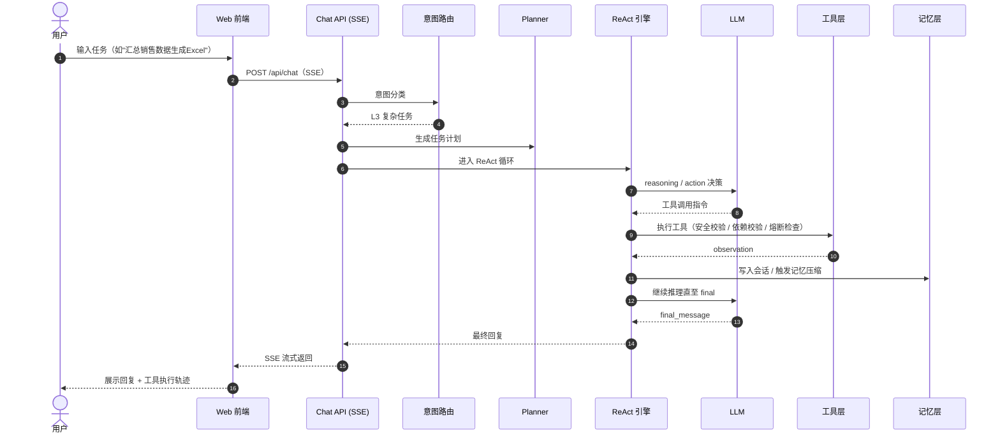

# smartDesktop 产品需求文档（PRD）

> 文档版本：v1.0
> 编写日期：2026-08-27
> 产品名称：smartDesktop —— 个人桌面 AI Agent 助手
> 文档状态：初稿（对齐现有实现 v1.x）

---

## 1. 产品概述

### 1.1 背景与问题

通用大模型（网页版 / API）只能"回答"，无法"动手"。用户在本地桌面的大量真实诉求——
查文件、算 Excel、写 Word / PPT、跑脚本、整理目录、管理进程——需要跨多个工具链的
多步操作，反复复制粘贴、手动切换应用，效率极低。

同时，现有 Agent 方案存在三类普遍痛点：

| 痛点 | 表现 | 后果 |
|---|---|---
| **上下文丢失** | 长对话中模型遗忘早期信息、跨会话不记得用户偏好 | 重复交代背景，体验割裂 |
| **任务中断** | 工具执行到一半进程崩溃 / 用户取消，无法续传 | 重头再来，浪费成本 |
| **安全失控** | Agent 随意执行高危命令、写入系统目录、陷入工具死循环 | 用户不敢放开权限 |

### 1.2 产品定位

**smartDesktop 是一款运行在用户本机的桌面 AI Agent 助手**：以自然语言为唯一交互入口，
通过「思考 → 行动 → 观察」的 ReAct 循环自主调用本地工具完成任务，并以**分层记忆、
任务检查点、安全沙箱**三大能力解决上述痛点。它是一个"能动手的助手"，而不是"能聊天的窗口"。

### 1.3 目标用户

- **主力用户**：本地开发者、数据分析师、办公重度用户（需要频繁产出文档 / 表格 / 演示文稿）。
- **尝鲜用户**：对 AI Agent 感兴趣、希望用自然语言操控电脑的个人用户。

### 1.4 产品目标

1. **任务完成度**：多步任务（如"统计销售数据并生成 Excel 报告"）一次对话内自主完成。
2. **记忆连续性**：长对话不丢关键信息，跨会话记住用户偏好与项目背景。
3. **安全可信**：高危操作分级确认，敏感目录拦截，工具调用不死循环。
4. **低成本可跑**：模型后端可切换（云端多厂商 / 本地 Ollama），本地无 GPU 也可用。

---

## 2. 用户画像与核心场景

### 2.1 用户画像

| 画像 | 特征 | 典型诉求 |
|---|---|---
| **效率型办公用户** | 每天处理 Excel / Word / PPT，讨厌重复劳动 | "把 6 月销售数据汇总成新表" |
| **开发型用户** | 本地写代码、跑脚本、查系统 | "帮我写个脚本批量重命名文件" |
| **研究型用户** | 需要搜索、抓取网页、整理资料 | "调研一下 XX 竞品，整理成报告" |

### 2.2 核心使用场景（P0）

**场景一：数据报表自动化**
> "帮我在下载文件夹里找 6 月的销售 Excel，统计各产品总销售额，把结果写成新表，再复制一份到我桌面的工作区。"

Agent 行为链路：意图路由 → 文件搜索 → Excel 读取 → Python 聚合计算 → 写新 Excel → 复制到工作区 → 汇报结果。

**场景二：文档 / 演示文稿产出**
> "帮我做一份关于 AI 发展的 PPT，10 页左右，配图和结构要专业。"

Agent 行为链路：意图路由 → 加载 PPT 技能域 → 规划章节 → 逐页生成（主题 / 文字 / 图表）→ 产出 .pptx 文件。

**场景三：系统操作与安全确认**
> "帮我把 C 盘某个文件夹里 3 天前的临时文件删掉。"

Agent 行为链路：意图路由 → 扫描目录 → 列出待删文件 → **P0 风险确认弹窗** → 用户确认后执行删除 → 操作后验证。

**场景四：长期记忆的跨会话助手**
> （周一）"我是做数据分析的，常用 Python。"
> （周五）"帮我写个脚本处理新到的数据。" → Agent 自动带入用户背景与偏好，直接产出贴合脚本。

---

## 3. 用户需求与产品目标映射

| 用户需求 | 对应产品能力 | 验收标准 |
|---|---|---|
| 用一句话完成多步任务 | L3 复杂任务规划 + ReAct 循环 + 动态技能域 | 上述场景一 / 二可一次对话完成 |
| 对话久了不"失忆" | 四层记忆体系（工作记忆 / 情节缓存 / 历史摘要 / 长期记忆） | 20 轮以上长对话关键信息不丢 |
| 跨会话记得我是谁 | 长期记忆（user / projects / skills / facts）+ 事实提取 | 新会话自动召回用户画像 |
| 任务中断能续上 | SQLite 任务检查点 + 断点续传 | 中断后恢复可精确续传 |
| 不怕它乱来 | P0-P3 风险分级 + 敏感路径拦截 + 三层熔断 | 高危操作必须经确认；系统目录不可写 |
| 离线 / 低成本可用 | 多模型后端（云端 + Ollama 本地） | 无 API Key 时可用本地模型对话 |

---

## 4. 功能需求（FR）

### 4.1 功能架构总览

```
┌─────────────────────────────────────────────────────────┐
│  用户界面层（Web 聊天页 + 运行日志查看器）                │
├─────────────────────────────────────────────────────────┤
│  API 层（SSE 流式聊天 / 会话管理 / 模型配置 / 上传）      │
├─────────────────────────────────────────────────────────┤
│  意图路由层（L0 直答 → L1 本地规则 → L2 LLM → L3 规划）   │
├─────────────────────────────────────────────────────────┤
│  引擎层（ReAct 循环 / 状态管理 / 进度控制 / 检查点）       │
├─────────────────────────────────────────────────────────┤
│  记忆层（工作记忆 / 情节缓存 / 历史摘要 / 长期记忆 / BM25）│
├─────────────────────────────────────────────────────────┤
│  工具层（13 类工具域 / 动态注册 / 安全执行沙箱）           │
├─────────────────────────────────────────────────────────┤
│  LLM 适配层（DeepSeek / 混元 / 千问 / 智谱 / 豆包 / Ollama）│
└─────────────────────────────────────────────────────────┘
```

### 4.2 功能模块清单

| 编号 | 模块 | 优先级 | 功能说明 |
|---|---|---|---|
| FR-01 | 聊天对话 | P0 | Web 页面输入自然语言，SSE 流式返回回复与工具执行轨迹 |
| FR-02 | 意图路由 | P0 | L0 问候直答 / L1 时间日期本地直答 / L2 LLM 简单任务 / L3 复杂任务规划 |
| FR-03 | ReAct 执行循环 | P0 | 推理 → 工具调用 → 观察，最多 15 轮，支持多 tool_calls 并行 |
| FR-04 | 动态技能域 | P0 | 12+ 类工具按需注册加载（文件 / Word / PPT / Excel / 系统 / 代码 / 搜索 / GUI / 下载 / 数据库 / 技能学习 / 截图） |
| FR-05 | 四层记忆 | P0 | 工作记忆（JSON）、情节缓存（最近 3 轮）、历史摘要（LLM 压缩）、长期记忆（Markdown + 检索） |
| FR-06 | BM25 上下文路由 | P0 | 纯统计任务切换检测：新任务自动清空旧工具链与思考轨迹 |
| FR-07 | 安全确认 | P0 | P0-P3 风险分级；写/删/移动等操作弹确认框；120s 内同参数确认去重 |
| FR-08 | 敏感路径保护 | P0 | 系统目录（Windows / Program Files / ProgramData）读写复制拦截；隐私目录（.ssh / .aws 等）保护 |
| FR-09 | 三层熔断 | P0 | 循环检测（同工具连调 / 同参数重复）+ 同名失败计数 + 全局失败上限 |
| FR-10 | 任务检查点 | P1 | SQLite 持久化检查点，中断后断点续传，24h 自动清理 |
| FR-11 | 技能习惯固化 | P1 | 记录工具使用轨迹，观察窗口内稳定后固化为技能模板，命中直连执行 |
| FR-12 | 操作后验证 | P1 | 关键操作执行后自动验证状态（文件是否存在 / 内容是否写入） |
| FR-13 | 多模型配置 | P1 | 7 种模型预设（DeepSeek / 混元 / 千问 / 智谱 / 豆包 / OpenAI / Ollama 本地），可自定义 |
| FR-14 | 运行日志查看 | P2 | 独立 log_viewer 页面，查看 reasoning_trace 与 tool_call 结构化日志 |
| FR-15 | 会话管理 | P2 | 多会话隔离、标题生成、历史会话列表、删除会话 |
| FR-16 | 文件上传 | P2 | 上传附件作为对话上下文 |
| FR-17 | 经验内化 | P2 | 工具使用经验沉淀为可复用技能（experience_db） |
| FR-18 | 进度摘要 | P2 | 接近最大轮次时自动生成任务进度摘要并保存检查点 |

### 4.3 核心流程：一次复杂任务的完整链路



### 4.4 非功能性需求（NFR）

| 编号 | 类别 | 需求 | 指标 |
|---|---|---|---|
| NFR-01 | 性能 | 单轮 LLM 首字延迟 | 流式返回，首字 < 2s（网络正常时） |
| NFR-02 | 性能 | 上下文预算控制 | MAX_CONTEXT_TOKENS=28000，超限触发思考摘要压缩 |
| NFR-03 | 可靠 | 任务中断恢复 | 检查点 24h 内可恢复；僵尸会话自动清理（60s 巡检） |
| NFR-04 | 安全 | 高危操作 | P0 必须人工确认；敏感路径直接拒绝；命令超时 120s |
| NFR-05 | 安全 | 防死循环 | 同工具连调 ≥3 次 / 域内连调 ≥6 次 / 同参重复 ≥3 次 → 熔断 |
| NFR-06 | 资源 | 数据存储 | 全部本地化（%APPDATA%\smartDesktop），SQLite WAL 模式 |
| NFR-07 | 兼容 | 模型后端 | 兼容 OpenAI 协议 + Ollama 原生；本地无 GPU 可运行 |
| NFR-08 | 可用 | 降级策略 | LLM 不可用时问候 / 时间 / 日期仍可直答；天气无工具时降级 L2 |

---

## 5. 交互与界面需求

### 5.1 主界面（Web 聊天页 `web/index.html`）

- **消息区**：用户消息与助手回复气泡流式展示；工具调用以结构化轨迹卡片展示（工具名 / 参数 / 结果 / 耗时）。
- **输入区**：多行文本输入，支持回车发送、Shift+Enter 换行。
- **会话侧栏**：历史会话列表，可新建 / 切换 / 删除会话。
- **状态区**：当前模型标识、会话状态（运行中 / 可取消）。

### 5.2 安全确认交互

- 触发条件：命中 P0-P2 风险工具（删除文件、修改注册表、移动文件、GUI 点击等）。
- 交互形式：对话内确认卡片，展示工具名、关键参数、风险等级；用户可"确认 / 拒绝"。
- 去重规则：同一工具 + 同一关键参数 120 秒内确认过 → 不再重复弹窗。
- 超时规则：确认等待默认 60s（CONFIRMATION_TIMEOUT），超时视为取消。

### 5.3 日志查看页（`web/static/log_viewer.html`）

- 独立页面，实时展示 `reasoning_trace`（思考轨迹 JSON）与 `tool_call`（工具调用链）结构化日志。
- 支持按会话 / 级别 / 关键字过滤。
- 面向调试与面试演示，展示"可追溯的思考过程"。

### 5.4 异常与降级体验

| 场景 | 用户体验 |
|---|---|
| 任务被熔断 | 明确提示熔断原因（连续失败 / 循环检测），建议换一种方式表达 |
| 高危操作被拒 | 说明拒绝原因（敏感路径 / 风险等级），不静默失败 |
| 模型请求超时 | 超时（30s）后提示重试或切换模型 |
| 工具缺失 | 自动触发 `load_domain_skills` 按需加载；加载失败给出可读错误 |
| 上下文超限 | 自动压缩摘要后继续，不中断对话 |

---

## 6. 数据需求

### 6.1 数据存储规划（`%APPDATA%\smartDesktop\`）

| 数据 | 存储形式 | 说明 |
|---|---|---|
| 长期记忆 | Markdown（user.md / projects.md / skills.md / facts.md / summaries.md / custom/） | 跨会话用户画像，关键词向量检索 |
| 短期记忆 | SQLite（per-session messages.db / summaries.db） | 按会话隔离的原始消息与压缩摘要 |
| 会话元数据 | JSON（sessions_meta.json / active_session.txt） | 会话列表、标题、当前会话 |
| 链路追踪 | SQLite（agent_trace.db） | reasoning_trace + tool_call 全链路日志 |
| 操作审计 | SQLite（operation_log.db） | 高危操作审计留痕 |
| 任务检查点 | SQLite（checkpoints.db） | 断点续传数据，24h 清理 |
| 模型配置 | JSON（models.json） | 多模型 API Key / Base URL / 模型列表 |
| 用户画像 | JSON（user_profile.json） | 用户偏好画像 |

### 6.2 关键数据流

1. **上下文构建**（每轮 LLM 调用前）：
   `[system prompt] + [长期记忆 top-k] + [历史摘要] + [情节缓存 3 轮] + [工作记忆] + [当前用户任务]`
2. **任务切换**：BM25 归一化相似度 < 0.25 → 判定新任务 → 清空旧工具链与思考轨迹。
3. **记忆压缩**：轮数 > 3 触发增量压缩，最老一轮并入历史摘要；目标注入 token ≈ 800。
4. **检查点**：每轮结束保存 messages / completed_steps / remaining_steps / current_tool。

---

## 7. 风险与应对

| 风险 | 影响 | 应对 |
|---|---|---|
| LLM 幻觉式"假成功"（宣称完成但未产出文件） | 任务失败不可见 | 引擎产物护栏：文件类任务无工具调用却宣称成功 → 强制注入提示继续执行 |
| 模型 API 不稳定 / 限流 | 任务中断 | 多模型可切换；超时重试；检查点续传 |
| Agent 陷入工具循环 | 资源浪费 | 三层熔断（循环检测 / 失败计数 / 全局上限） |
| 误操作破坏系统 | 数据丢失 | P0-P3 分级确认 + 敏感目录拦截 + 操作后验证 |
| 本地无 GPU 无法跑大模型 | 无法使用 | Ollama 本地小模型兜底 + 云端多厂商可选 |
| 会话并发竞态 | 状态错乱 | 会话级引擎复用 + request_id 防竞态 + 僵尸会话清理 |

---

## 8. 里程碑规划

| 阶段 | 范围 | 交付物 |
|---|---|---|
| M1 基础对话 | 意图路由 L0/L1/L2 + LLM 接入 + SSE 流式 | 可对话的 MVP |
| M2 工具能力 | 文件 / Excel / Word / PPT / 系统工具 + ReAct 循环 | 能完成多步文件任务 |
| M3 记忆体系 | 四层记忆 + BM25 路由 + 压缩 | 长对话不丢上下文 |
| M4 安全加固 | 风险分级 / 敏感路径 / 熔断 / 检查点 | 可放心放开权限 |
| M5 进阶能力 | 技能固化 / 操作验证 / 进度摘要 / 经验内化 | 更聪明的 Agent |

> 注：以上阶段为回溯式整理，与现有代码实现（README 核心亮点）一一对应。

---

## 9. 成功指标

| 指标 | 定义 | 目标 |
|---|---|---|
| 任务完成率 | 复杂任务一次对话内产出有效文件 / 结果的比例 | ≥ 80%（P0 场景） |
| 记忆召回准确率 | BM25 任务切换判定与人工标注一致性 | ≥ 90% |
| 安全拦截率 | 高危操作 100% 经确认或被拦截 | 100% |
| 熔断触发及时性 | 死循环在 N 轮内被终止 | ≤ 3 轮 |
| 首字延迟 | 流式首字返回时间 | < 2s |

---

## 10. 附录

### 10.1 术语表

| 术语 | 含义 |
|---|---|
| ReAct | Reasoning + Acting，推理与行动交替的 Agent 范式 |
| BM25 | Okapi BM25 稀疏检索算法（Elasticsearch / Lucene 同款） |
| 技能域（Domain） | 一组相关工具的集合（如 excel_analyze、file_tools） |
| SSE | Server-Sent Events，服务端单向流式推送 |
| 检查点（Checkpoint） | 任务进度的持久化快照，用于断点续传 |
| 熔断（Circuit Breaker） | 防止工具调用死循环的保护机制 |
| 情节缓存（Episodic Buffer） | 最近 N 轮对话的结构化交互记录 |

### 10.2 参考文档

- 项目 README（架构图 / 数据目录 / 快速开始）
- `docs/ROADMAP.md`（演进路线）
- `docs/TEST_SUITE.md`、`docs/agent_test_suite.md`（测试套件）
