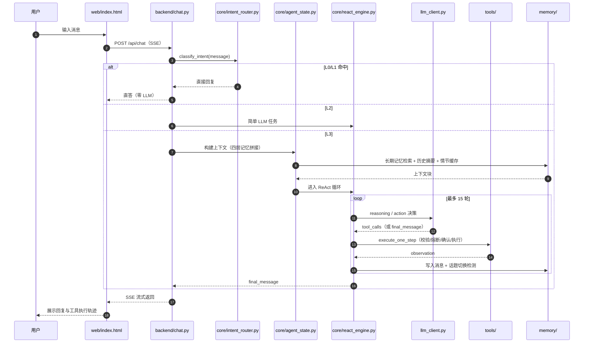

# smartDesktop 研发设计文档（Technical Design）

> 文档版本：v1.0
> 编写日期：2026-08-27
> 对应产品文档：`docs/PRD.md`
> 技术栈：Python 3.11 + Flask + SQLite（WAL）+ SSE + 多模型 LLM 适配

---

## 1. 设计目标与原则

### 1.1 设计目标

1. **可追溯**：每轮思考轨迹（reasoning_trace）结构化落库，工具调用全链路可复盘。
2. **不丢记忆**：四层记忆分层组织，LLM 增量压缩控制 Token 预算，长对话不失忆。
3. **不中断**：SQLite 检查点持久化，任务意外中断可精确断点续传。
4. **安全可控**：安全执行沙箱 + 风险分级确认 + 三层熔断，防死循环防误操作。
5. **零依赖路由**：BM25 纯统计任务切换检测，不消耗 LLM token，响应即时。

### 1.2 关键技术决策

| 决策点 | 选择 | 理由 |
|---|---|---|
| Agent 范式 | ReAct（Reasoning + Acting） | 任务可分解、可观测、可中断续传 |
| 意图路由 | 规则优先（L0/L1）→ LLM（L2）→ 规划（L3） | 简单请求零 LLM 成本，复杂任务完整规划 |
| 上下文路由 | 自研 BM25（零依赖） | 无向量模型 / 无外部依赖 / 完全离线 |
| 记忆存储 | SQLite（WAL）+ Markdown | 结构化查询 + 人类可读长期记忆 |
| 流式输出 | SSE | 单向推送简单可靠，前端逐字渲染 |
| 模型接入 | OpenAI 兼容协议 + Ollama 原生 | 一套客户端适配多厂商 |
| 并发模型 | 线程 + 会话级引擎复用 | 桌面单机场景，避免分布式复杂度 |

### 1.3 整体架构

```
┌──────────────────────────────────────────────────────────────┐
│ Web 层      web/index.html（聊天）                            │
│             web/static/log_viewer.html（日志查看）            │
├──────────────────────────────────────────────────────────────┤
│ API 层      backend/chat.py（SSE / 会话 / 确认 / 配置）        │
│             backend/upload_api.py（上传） backend/routing.py   │
├──────────────────────────────────────────────────────────────┤
│ 路由层      core/intent_router.py（L0-L3 分类，纯规则）        │
├──────────────────────────────────────────────────────────────┤
│ 引擎层      core/react_engine.py（ReAct 主循环）              │
│             core/agent_state.py（状态 / 检查点 / 熔断）        │
│             core/streaming.py（SSE 格式化 / 工具 worker）      │
│             core/planner.py（任务规划） core/progress_controller.py │
│             core/tool_data_provider.py（工具 schema / 管线）   │
│             core/safety_policy.py（风险定级 / 敏感路径）       │
├──────────────────────────────────────────────────────────────┤
│ 记忆层      memory/session.py（上下文构建）                   │
│             memory/context_router.py（BM25 任务切换）          │
│             memory/compressor.py（LLM 压缩）                  │
│             memory/extractor.py（事实提取）                   │
│             memory/long_term.py（长期记忆 Markdown + 检索）   │
│             memory/stores/sqlite_store.py / json_store.py     │
├──────────────────────────────────────────────────────────────┤
│ 工具层      tools/（file / word / ppt / excel / system / code │
│             / search / gui / web_download / db / safe_exec /  │
│             skill_learning / skill_fixation / post_action_verify │
│             / screenshot）                                    │
├──────────────────────────────────────────────────────────────┤
│ 适配层      llm_client.py（多厂商 OpenAI 兼容 + Ollama 原生）  │
│ 配置层      config/（settings.py / safety_rules.yaml /        │
│             memory_policy.yaml）                              │
└──────────────────────────────────────────────────────────────┘
```

---

## 2. 核心模块设计

### 2.1 意图路由层 `core/intent_router.py`

**设计要点：纯规则分类，零 LLM 调用，保证简单请求零成本。**

| 级别 | 规则 | 处理 |
|---|---|---|
| L0 | 问候 / 感谢 / 告别 / 身份 / 能力（正则硬编码） | 直接返回预设回复，完全不走 LLM |
| L1 | 时间 / 日期 / 星期（本地格式化）；天气（规则命中但无工具 → degraded） | 本地直答；degraded 降级 L2 |
| L2 | 默认档（写总结 / 解释概念 / 推荐等） | 走 LLM，无规划、无复杂工具链 |
| L3 | 「动作 + 产物」强信号（`(生成|创建|分析...).{0,12}(报告|PPT|Excel...)`） | 实例化 Planner 生成计划，进入 ReAct |

**关键细节：**
- L1 复合任务护栏：消息同时含任务信号词（帮我 / 写 / 生成 / 统计…）时，即使命中时间规则也不直答，回落 LLM，避免截断真实任务（如"几点了，顺便帮我写份报告"）。
- 输出 `IntentResult`：`route_level / reply / degraded / exec_action / exec_params / detail`。

### 2.2 ReAct 引擎层 `core/react_engine.py`

**设计要点：单用户消息 = `[system, user_content] + tools`，AI 在 reasoning / action / final 三阶段循环自主决策。**

```
for step in range(start_step, MAX_TURNS):   # MAX_TURNS = 15
    1. 取消信号检查（cancel_event）→ 取消则 safe_final 收尾
    2. call_llm_and_parse：LLM 决策 → parsed_action（tool_name/arguments 或 final_message）
       - 支持原生多 tool_calls（N 个并行调用）
       - assistant 消息只 append 一次，tool_calls 放完整列表，与 tool 消息一一对应
    3. 能力加载钩子：parsed_action 含 need_capability + domain →
       load_domain_skills(domain) 按需加载技能域，下一轮对话获得该域全部工具
    4. 遍历 pending_tool_calls → execute_one_step（见 2.6 工具管线）
    5. 熔断状态维护（BreakerState）
    6. 第 12 轮（WARNING_TURN）生成进度摘要并保存检查点
    7. 最终收尾 do_final_cleanup（释放日志 / 会话资源）
```

**引擎产物护栏（防幻觉）：**
- 文件产出类任务（消息含 ppt / word / excel / 文档 / 文件 / 代码等信号词）
- 且本会话无任何工具调用（completed_steps 为空）
- 且文本宣称成功（成功 / 完成 / 已创建 / 已生成 / ✅…）
- → 禁止直接结束，注入强制提示，要求调用真实工具生成并校验物理产物。

**核心常量：**

| 常量 | 值 | 说明 |
|---|---|---|
| MAX_TURNS | 15 | 单任务最大思考轮次 |
| MAX_CONSECUTIVE_PROGRESS | 3 | 连续有进展轮次上限 |
| MAX_CONSECUTIVE_FAILURES | 3 | 同名同参数连续真失败熔断 |
| MAX_GLOBAL_FAILURES | 4 | 全局连续失败上限 |
| MAX_CONTEXT_TOKENS | 28000 | 上下文 token 预算，超限压缩思考摘要 |
| MAX_RESULT_CHARS | 8000 | 工具结果注入上限 |
| CONFIRMATION_TIMEOUT | 60s | 确认等待超时 |

### 2.3 状态管理与检查点 `core/agent_state.py`

**设计要点：任务状态集中管理，SQLite 持久化，中断可续传。**

- `AgentTurnState / AgentExecutionState`：单轮 / 单会话执行状态。
- `TaskCheckpoint`：保存 messages、completed_steps、remaining_steps、current_tool。
- `CheckpointManager`：SQLite 持久化 + 24h 自动清理。
- `resumed_checkpoint`：通过 `agent.run()` 参数注入，断点续传。
- `RunState / PrepareResult`：可变状态与配置分离，承载跨方法状态同步。
- `safe_final`：拒绝 / 中止路径统一收尾，避免跳过 `do_final_cleanup` 导致资源泄漏。

### 2.4 会话生命周期 `backend/chat.py`

**设计要点：会话级 ReActEngine 跨 turn 复用，保留 context_detector 历史；request_id 防竞态。**

- `_session_engines`：会话 → 引擎缓存，注销后仍保留（避免每 turn 新建引擎丢历史）。
- `_active_sessions`：`{session_id: {started_at, thread_id, cancel_event, status, request_id, engine}}`。
- 新请求到达时：同会话旧任务先 cancel，再注册新任务。
- 僵尸会话清理线程：60s 巡检；cancelling > 10min 或 running 线程已死 → 清理。

### 2.5 记忆系统 `memory/`

#### 2.5.1 四层记忆体系

| 层级 | 存储 | 内容 | 时效 | 实现 |
|---|---|---|---|---|
| 工作记忆 | JSON（sessions_meta） | 状态变量、当前计划、最近观察、工具缓存 | 单次任务 | `memory/session.py` |
| 情节缓存 | SQLite（per-session messages.db） | 最近 3 轮结构化交互（子轮次精简） | 会话内 | `memory/episode_store.py` |
| 历史摘要 | SQLite（per-session summaries.db） | 超 3 轮后 LLM 压缩的自然语言摘要 | 会话内 | `memory/compressor.py` |
| 长期记忆 | Markdown（user / projects / skills / facts / summaries / custom） | 用户信息、项目、技能、事实 | 跨会话 | `memory/long_term.py` |

#### 2.5.2 上下文拼接机制（`build_context_messages`）

```
[system prompt（core.md + safety.md + output.md + skills + tool_list + persona）]
[长期记忆]          ← 关键词向量检索 top-k 匹配条目
[历史摘要]          ← 早期轮次（>3 轮）的自然语言压缩摘要
[情节缓存]          ← 最近 3 轮结构化 JSON（含工具调用链 + 精简结果）
[工作记忆]          ← 状态槽 / 当前计划 / 最近观察 / 工具缓存
[用户任务]          ← 当前轮用户原始输入
```

**情节缓存裁剪规则：**
- 最近 2 个子轮次：完整保留思考轨迹（reasoning_trace）
- 更早子轮次：剥离思考轨迹，仅保留工具名 + 参数 + 结果

**压缩策略：**
- `COMPRESS_THRESHOLD = 3`：超过 3 轮触发增量压缩，最老一轮合并进历史摘要
- 压缩模型独立配置，默认 `deepseek-chat`
- 摘要最大注入 token ≈ 800

**Token 三级预算：**

| 阈值 | 值 | 动作 |
|---|---|---|
| TOKEN_SOFT_THRESHOLD | 30000 | 警告，准备压缩 |
| TOKEN_HARD_THRESHOLD | 50000 | 强制压缩，目标 TOKEN_TARGET = 15000 |
| MAX_CONTEXT_TOKENS | 28000 | ReAct 引擎内触发思考摘要压缩 |

#### 2.5.3 BM25 上下文路由（`memory/context_router.py`）

**核心算法：Okapi BM25（Elasticsearch / Lucene 同款稀疏检索），零依赖纯 Python math。**

- **分词**：中文双字重叠 bigram + 单字 fallback + 英文/数字连续序列 + 滑动 bigram 打散。
  - 例："生成PPT卸载Qoder" → bigrams `[生成, ppt, 卸载, qoder]` + chars `[生, 成, pp, t, 卸, 载, qo, de, r]`
  - 单字跳过常见停用字（的是不了在有一我他她它这那也…）
- **任务切换判定**：新输入与最近 N 轮（window_size=5）历史分别计算 BM25 分数；
  归一化相似度 `norm_similarity < 0.25`（strict_threshold）→ 任务切换，清空旧工具调用链与思考轨迹。
- **延续指令识别**：≤8 字短指令、"继续/然后/好的/收到" 等续写模式自动继承上下文；
  低质量语料（过短 / 纯续写 / 确认类）不进入话题语料库，保证切换判定不失真。
- **参数**：`k1=1.5, b=0.75`（BM25 标准参数）。

### 2.6 工具系统 `tools/`

#### 2.6.1 注册中心 `tools/__init__.py`

- `TOOL_REGISTRY`：全局工具注册表（装饰器 `@register_tool(timeout=…)` 惰性注册）。
- `_ensure_tool_registration()`：惰性初始化，将注册工具同步到 `tool_data_provider` 获取完整 schema。
- `tool_data_provider`：统一工具 schema 管理（参数校验 / 域匹配 / API 参数构建），约 2400 行核心。
- `load_domain_skills(domain, reason, session_id)`：按需加载技能域，返回 `{success, tools, message}`。
- `build_dynamic_system_prompt(domains)`：组装 core + safety + output + skills + tool_list + persona。
- Prompt 文件缓存带 mtime 检测，支持热更新。

#### 2.6.2 工具分类（13 类）

| 文件 | 工具类型 | 典型工具 |
|---|---|---|
| file_tools.py | 文件系统 | search_files / read_file / write_file / edit_file / copy_file / move_file / delete_file / scan_directory |
| word_tools.py | Word 文档 | Word 创建 / 编辑 / 格式 |
| ppt_tools.py | PPT 演示 | PPT 创建 / 加页 / 加文字 / 加图 / 加图表 |
| excel_tools（tool_data_provider 域） | Excel | excel_read / write / pivot / format / chart / merge / formula / convert |
| system_tools.py | 系统操作 | 命令执行 / 进程管理 / 注册表 / 环境变量 |
| code_tools.py | 代码 | run_python / 代码生成执行 |
| search_tools.py | 网页 | 网页搜索 / 内容抓取 |
| gui_tools.py | GUI 自动化 | 截图 / 点击 / 输入 / 按键 / 打开应用 |
| web_download.py | 文件下载 | 下载 URL 到本地 |
| db_tools.py | 数据库 | 数据库查询 |
| safe_exec.py | 安全执行器 | 命令预检拦截 + 风险分级（P0-P3）+ 挑战短语确认 |
| skill_learning.py | 技能学习 | 经验内化 / 技能模板沉淀 |
| skill_fixation.py | 技能固化 | 工具使用轨迹固化，命中直连执行 |
| post_action_verify.py | 操作后验证 | 关键操作后状态校验 |
| screenshot_tools.py | 截图 | 屏幕截图 |

#### 2.6.3 安全执行沙箱 `tools/safe_exec.py`（约 840 行）

- **命令预检拦截**：危险命令模式匹配，命中即拒绝。
- **风险分级确认**：P0-P3 四级；P0 强制确认（含挑战短语，防 LLM 注入 `confirmed=True` 绕过）。
- **超时控制**：命令 120s / Python 300s 超时，输出截断 2000 字符。
- **敏感路径保护**：与 `core/safety_policy.py` 联动（见 2.7）。

### 2.7 安全策略 `core/safety_policy.py`

**设计要点：敏感路径分级保护 + Zone 划分 + 风险动态定级。**

- **敏感读取根**：仅 `C:\Windows`（读取语义放宽：Program Files / ProgramData 允许读取）。
- **敏感复制根**：`C:\Windows`、`C:\Program Files`、`C:\Program Files (x86)`、`C:\ProgramData` 四目录全保护（杜绝"复制系统文件到工作区再读取"的绕过路径）。
- **Zone 划分**：SAFE（工作区）/ USER / APP / SYSTEM / SECRET（凭据隐私）/ NET / UNKNOWN。
- **隐私目录**：.ssh / .aws / .kube / .gnupg / .config / .cache / Chrome 数据 / keyring / credentials 等 → SECRET。
- **风险动态定级**（`check_tool_risk_level`）：
  - 目标在 C 盘且不在 `C:\Users\<当前用户>` 下 → P0 直接拒绝
  - 其余（用户目录内或非 C 盘）→ P2 简单确认
- **静态风险映射**（ReActEngine.RISK_LEVELS）：modify_registry / delete_file = P0；move_file / gui_click / gui_type_text / gui_press_keys / gui_mouse_click = P1；write_file / edit_file / replace_in_file / copy_file / scan_directory / web_download / gui_open_application / gui_screenshot / gui_mouse_move = P2；其余默认 P3。

### 2.8 三层递进式熔断

| 层 | 检测 | 阈值 | 动作 |
|---|---|---|---|
| 循环检测 | 连续调用同一工具（不限参数） | MAX_SAME_TOOL_STREAK = 3 | 拒绝执行本轮 |
| 循环检测（域级） | 域内任意工具连续调用 | MAX_DOMAIN_TOOL_STREAK = 6 | 强制终止 |
| 失败计数 | 同一工具连续失败（success:false） | MAX_CONSECUTIVE_FAILURES = 3 | 熔断注入提示 |
| 精确重复 | 同一工具同一参数连调 | MAX_EXACT_REPEAT = 3 | 拒绝执行 |
| 全局上限 | 全局连续失败 | MAX_GLOBAL_FAILURES = 4 | 终止任务 |
| 搜索熔断 | 搜索工具失败 | failure_threshold=3, cooldown=60s | 冷却期内跳过搜索 |

### 2.9 工具执行管线 `core/tool_data_provider.py`

`ToolExecutionPipeline` 串联执行单步工具：

```
execute_one_step:
  1. 工具查找（tool_data_provider 取 schema）+ 参数校验
  2. 依赖校验（utils/dependency_manager.feature_availability）
  3. 熔断检查（ToolLoopDetector / SearchCircuitBreaker / BreakerState）
  4. 风险定级（check_tool_risk_level）→ P0/P1 走确认（confirmation_handler）
     - 确认缓存：同一工具 + 同关键参数 120s 内确认过 → 不再弹窗
  5. 执行（_tool_worker 线程 / 进程隔离，超时控制）
  6. 结果处理：截断（MAX_RESULT_CHARS=8000）/ 失败分类（classify_tool_failure）
  7. handle_tool_success / handle_tool_failure：更新熔断计数、写入会话消息
  8. 结果注入下一轮 LLM 上下文（tool 消息，tool_call_id 一一对应）
```

### 2.10 进度控制 `core/progress_controller.py`

- `ProgressEvaluator`：评估每轮工具调用是否带来实质进展，输出 `Verdict`。
- 连续无进展 → 触发熔断 / 换策略提示。
- 功能开关：`PROGRESS_EVALUATOR_ENABLED`。

### 2.11 LLM 适配层 `llm_client.py`

| 能力 | 实现 |
|---|---|
| OpenAI 兼容协议 | DeepSeek / 混元 / 千问 / 智谱 / 豆包 / OpenAI / 自定义（base_url 可配） |
| Ollama 原生 | `_ollama_call_stream`（/api/generate、/api/chat 端点），默认 deepseek-r1:7b |
| 流式 | `stream_llm_response` / `_deepseek_call_stream` / `_ollama_call_stream` |
| 解析 | `parse_ai_json`（容错 JSON 解析）、`ai_concat`（普通聚合调用） |
| 防御路由 | DEEPSEEK_MODEL_NAMES 名单，拒绝在线模型误路由到本地 Ollama |
| 可用模型 | `get_available_models`（读取 models.json + 探测 Ollama） |
| 默认参数 | temperature=0.3（聊天），LLM_TIMEOUT=30s |

### 2.12 模型预设 `config/settings.py`

| 预设 | base_url | models |
|---|---|---|
| deepseek | https://api.deepseek.com | deepseek-chat / deepseek-reasoner |
| hunyuan | https://api.hunyuan.cloud.tencent.com/v1 | hunyuan-turbos-latest / hunyuan-lite |
| qwen | https://dashscope.aliyuncs.com/compatible-mode/v1 | qwen-turbo / qwen-plus / qwen-max |
| zhipu | https://open.bigmodel.cn/api/paas/v4 | glm-4-flash / glm-4-plus |
| doubao | https://ark.cn-beijing.volces.com/api/v3 | doubao-lite-128k / doubao-pro-256k |
| openai | https://api.openai.com/v1 | gpt-4o / gpt-4o-mini |
| ollama | http://localhost:11434/v1 | 本地模型（能力弱于云端） |
| custom | 用户自定义 | — |

---

## 3. 数据设计

### 3.1 SQLite Schema 要点

| 数据库 | 位置 | 表 / 内容 |
|---|---|---|
| messages.db（per-session） | `memory/short_term/<session_id>/` | 会话原始消息（role / content / msg_type / tool_call_id / reasoning_trace） |
| summaries.db（per-session） | `memory/short_term/<session_id>/` | 压缩摘要（按轮次追加） |
| agent_trace.db | `%APPDATA%\smartDesktop\logs\` | 链路追踪（reasoning_trace / tool_call 全链路） |
| operation_log.db | `%APPDATA%\smartDesktop\logs\` | 操作审计（高危操作留痕） |
| checkpoints.db | `%APPDATA%\smartDesktop\` | 任务检查点（24h 清理） |

### 3.2 SQLite 连接管理（`memory/stores/sqlite_store.py`）

- **线程本地连接池**：`_ThreadLocalPool`，按 db_path 缓存连接，LRU 追踪控制每线程连接上限（8 个）。
- **连接健康检查 + 重试**：`_get_conn` 最多 3 次尝试。
- **连接级互斥锁**：串行化"连接使用"与"跨线程关闭"，避免 sqlite3 C 层并发 close 冲突。
- **删除中路径保护**：`delete_chat_session` 期间置 `_deleting_paths` 标记，其他线程最多等待 2s，避免 rmtree 窗口内 WinError 32。
- WAL 模式启用。

### 3.3 长期记忆 Markdown 结构

```
memory/long_term/
├── user.md        # 用户画像（职业、偏好、常用工具）
├── projects.md    # 项目背景
├── skills.md      # 用户技能
├── facts.md       # 事实条目
├── summaries.md   # 长期摘要
└── custom/        # 自定义技能目录
```

- 写入：`extractor.py` 从对话中抽取事实（用户信息 / 偏好 / 技能），`_rewrite_md` 增量维护。
- 检索：关键词向量检索 top-k 匹配条目注入上下文。

---

## 4. API 设计

### 4.1 聊天接口（SSE 流式）

```
POST /api/chat
Content-Type: application/json

Request:
{
  "session_id": "xxx",
  "message": "帮我在下载文件夹找6月销售Excel并统计",
  "model_choice": {"model": "deepseek-chat", "provider": "deepseek"},
  "planning_extra": "",
  "resume_checkpoint_id": null
}

Response: text/event-stream（SSE）
事件类型（core/streaming.py SSEStreamer / format_sse_event）：
  - step            # 进度步骤（如"即将达到最大轮次"）
  - error           # 错误（translate_error 友好化）
  - final           # 最终回复（emit_final）
  - tool_call       # 工具调用发起（名称/参数，emit_tool_call）
  - tool_result     # 工具执行结果（名称/结果/args，emit_tool_result）
  - reasoning       # 思考轨迹展示（emit_reasoning）
  - confirm         # 安全确认请求（confirmation_token/标题/风险等级，emit_confirm）
```

### 4.2 会话管理

| 接口 | 方法 | 说明 |
|---|---|---|
| `/api/sessions` | GET | 会话列表（含标题） |
| `/api/sessions/<id>` | GET / DELETE | 会话详情 / 删除 |
| `/api/sessions/<id>/messages` | GET | 会话消息历史 |
| `/api/sessions` | POST | 新建会话 |

### 4.3 模型与配置

| 接口 | 方法 | 说明 |
|---|---|---|
| `/api/models` | GET | 可用模型列表（含 Ollama 探测） |
| `/api/models` | POST | 保存模型配置（models.json） |
| `/api/config` | GET / POST | 全局配置读取 / 更新 |
| `/api/user-profile` | GET / POST | 用户画像读取 / 更新 |

### 4.4 其他

| 接口 | 方法 | 说明 |
|---|---|---|
| `/api/upload` | POST | 文件上传（作为对话上下文附件） |
| `/api/chat/cancel` | POST | 取消当前任务（cancel_event 置位） |
| `/api/confirm` | POST | 安全确认响应（confirm / deny） |
| `/api/checkpoints` | GET | 检查点列表（断点续传入口） |
| `/api/logs` | GET | 运行日志（log_viewer 数据源） |

---

## 5. 关键流程时序

### 5.1 单用户消息完整链路



### 5.2 任务切换检测流程

```
用户新消息 → ContextSwitchDetector.detect()
  ├─ 延续指令？(≤8字 / 继续 / 然后 / 好的…) → 继承上下文，不切换
  ├─ 低质量语料？(过短 / 纯续写) → 不入语料库
  ├─ BM25 相似度 ≥ 0.25 → 同一任务，保留工具链
  └─ BM25 相似度 < 0.25 → 任务切换：清空旧工具调用链 + 思考轨迹
```

### 5.3 安全确认流程

```
工具调用 → check_tool_risk_level（动态定级）
  ├─ P0（系统目录写/删/注册表）→ 拒绝 or 强制确认（挑战短语）
  ├─ P1（移动/GUI 操作）→ 确认框
  ├─ P2（用户目录写/复制/下载）→ 确认框（120s 同参去重）
  └─ P3（只读/查询）→ 直接执行
用户确认 → 执行 → post_action_verify 验证 → 结果注入上下文
```

---

## 6. 部署与运行

### 6.1 运行环境

| 项 | 要求 |
|---|---|
| Python | 3.11+ |
| 系统 | Windows（路径保护针对 Windows 目录设计；跨平台需适配） |
| 依赖 | requirements.txt（生产）/ requirements-dev.txt（测试）/ requirements-ci.txt（CI） |
| LLM | 任一厂商 API Key 或本地 Ollama（默认 deepseek-chat） |

### 6.2 启动

```bash
pip install -r requirements.txt
python app.py                      # 默认端口 8765（AGENT_PORT 可覆盖）
# 配置 API Key：编辑 %APPDATA%\smartDesktop\models.json
# 首次可复制 models.example.json 作为模板
```

### 6.3 配置体系

| 配置 | 文件 | 说明 |
|---|---|---|
| 全局常量 | config/settings.py | 超时 / 模型预设 / 熔断参数 / 功能开关 |
| 记忆策略 | memory/config/memory_policy.yaml | 压缩 / 提取 / 检索参数，YAML 热重载 |
| 安全规则 | config/safety_rules.yaml | 危险命令 / 敏感路径规则 |
| Prompt 模板 | prompts/（core / safety / output / modes / skills / tools.yaml） | mtime 热更新 |
| 模型配置 | %APPDATA%\smartDesktop\models.json | API Key / Base URL / 模型列表 |

### 6.4 CI / 质量保障

- GitHub Actions（.github/workflows/ci.yml）+ pre-commit（.pre-commit-config.yaml）。
- 测试套件：tests/（test_core / test_cases / test_data / snapshots / artifacts）。
- 文档：docs/TEST_SUITE.md、docs/agent_test_suite.md。

---

## 7. 性能与资源设计

| 项 | 设计 |
|---|---|
| 上下文预算 | MAX_CONTEXT_TOKENS=28000；三级 Token 预算（30000 警告 / 50000 强制压缩至 15000） |
| 工具结果截断 | MAX_RESULT_CHARS=8000；命令输出截断 2000 字符 |
| HTML 抓取 | HTML_PARSE_MAX_CHARS=15000 截断 |
| 日志 | 缓冲刷盘（5s / 50 条），总量 500MB 阈值弹窗提醒 |
| SQLite | WAL 模式 + 线程本地连接池（每线程 ≤8）+ 健康检查重试 |
| 并发 | 线程模型 + 会话级引擎复用 + 僵尸会话清理（60s 巡检） |
| 检查点 | SQLite 持久化，24h 自动清理 |

---

## 8. 测试策略

| 层 | 内容 |
|---|---|
| 单元测试 | 意图路由规则（L0/L1/L3 命中 / 复合任务护栏）、BM25 分词与切换判定、熔断计数、风险定级 |
| 集成测试 | ReAct 循环端到端（mock LLM）、工具执行管线（校验→熔断→确认→执行→回注） |
| 场景测试 | tests/test_cases：文件任务 / PPT 生成 / Excel 报表 / 安全拒绝 / 记忆召回 |
| 安全测试 | 敏感路径绕过（复制系统文件到工作区）、P0 注入 confirmed=True 绕过、死循环熔断 |
| 回归测试 | tests/snapshots 快照对比 |

---

## 9. 已知边界与后续演进

### 9.1 已知边界

- L1 音量 / 天气等预设路由依赖的工具未实现（exec_action 恒为空），相关问句安全降级走 LLM（见 docs/ROADMAP.md）。
- 平台强相关：敏感路径保护面向 Windows 目录设计。
- 单机部署：并发模型为线程级，未做分布式。

### 9.2 后续演进方向

1. 向量记忆升级：BM25 之上叠加 embedding 语义检索（当前零依赖是特性，也是上限）。
2. 多模态工具：截图理解 → 图像 Agent 联动。
3. GUI 自动化增强：基于视觉的 UI 定位替代坐标点击。
4. 技能市场：技能模板跨用户共享。
5. 打包分发：PyInstaller 打包为桌面应用（数据目录已在 %APPDATA% 预留）。

---

## 10. 附录

### 10.1 目录结构速查

```
smartDesktop/
├── app.py                  # Flask 入口（优雅停机 / 工具注册 / CORS）
├── llm_client.py           # 多厂商 LLM 适配（OpenAI 兼容 + Ollama 原生）
├── logger.py               # 日志系统
├── core/                   # 引擎层
│   ├── react_engine.py     # ReAct 主循环
│   ├── agent_state.py      # 状态 / 检查点 / 熔断
│   ├── intent_router.py    # L0-L3 意图路由
│   ├── streaming.py        # SSE 流式格式化
│   ├── tool_data_provider.py # 工具 schema / 执行管线（最大模块）
│   ├── safety_policy.py    # 风险定级 / 敏感路径
│   ├── planner.py / plan.py / progress_controller.py / confirmation_manager.py / message_builder.py
├── memory/                 # 记忆层
│   ├── session.py          # 上下文构建（~1845 行）
│   ├── context_router.py   # BM25 任务切换
│   ├── compressor.py / extractor.py / episode_store.py / long_term.py / llm.py / config.py
│   └── stores/             # sqlite_store.py / json_store.py
├── tools/                  # 工具层（15 个模块）
│   ├── __init__.py         # 注册中心 / 域加载 / prompt 构建
│   ├── safe_exec.py        # 安全执行沙箱（~842 行）
│   ├── system_tools.py     # 系统操作（~2354 行，最大工具模块）
│   └── ...                 # file / word / ppt / code / search / gui / db / web_download / skill_learning / skill_fixation / post_action_verify / screenshot
├── backend/                # API 层
│   ├── chat.py             # SSE 聊天 / 会话 / 确认（~1027 行）
│   ├── routing.py          # 路由匹配 / 分层 / 频控（~1088 行）
│   ├── agent.py / upload_api.py / experience_db.py / rate_limiter.py / services.py
├── web/                    # 前端
│   ├── index.html          # 聊天页
│   └── static/log_viewer.html # 日志查看器
├── config/                 # settings.py / config_loader.py / safety_rules.yaml
├── prompts/                # core.md / safety.md / output.md / tools.yaml / modes/ / skills/
├── ppt_generator/          # HTML→PPTX 渲染引擎
├── utils/                  # dependency_manager.py / error_mapper.py
└── scripts/                # setup_config.py
```

### 10.2 关键常量速查（config/settings.py）

| 常量 | 值 | 用途 |
|---|---|---|
| DEFAULT_MODEL | deepseek-chat | 默认模型 |
| DEFAULT_TEMPERATURE | 0.3 | 默认温度 |
| LLM_TIMEOUT / SEARCH_TIMEOUT | 30s | API / 搜索超时 |
| COMMAND_TIMEOUT / PYTHON_TIMEOUT | 120s / 300s | 命令 / 代码执行超时 |
| CONFIRM_TIMEOUT | 300s | 确认等待超时 |
| MAX_SAME_TOOL_STREAK / MAX_DOMAIN_TOOL_STREAK | 3 / 6 | 熔断阈值 |
| MAX_EXACT_REPEAT | 3 | 同参重复阈值 |
| AGENT_PORT / AGENT_HOST | 8765 / 127.0.0.1 | 服务监听 |
| LOG_FLUSH_INTERVAL / LOG_MAX_BUFFER_SIZE | 5s / 50 条 | 日志刷盘 |
| LOG_SIZE_LIMIT_MB | 500 | 日志总量阈值 |
| SKILL_WINDOW_DAYS / SKILL_MIN_DAYS | 14 / 3 | 技能固化观察窗 |
| SKILL_BM25_THRESHOLD | 0.5 | 技能命中阈值 |
